
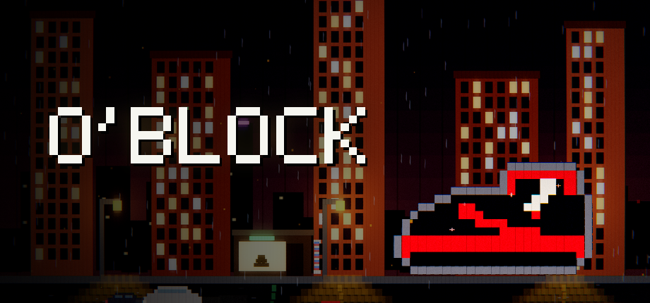

# O'BLOCK press kit

**A roguelike about flipping sneakers. The only verb is naming a price.**

[Steam page](https://store.steampowered.com/app/5357680/?utm_source=presskit) · Free · Windows · Out **October 20, 2026**

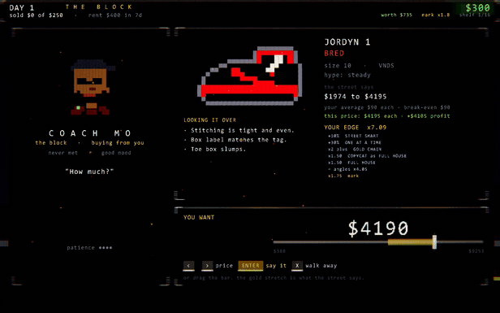

## The pitch

You start with $300 and a pair of Bred 1s in Parkway Gardenz. Every deal is a negotiation against someone with a hidden number, a mood and a patience. They never say what they'll take. They tell you how far off you are, in their own way. Read it, name a price, and climb from the block to the billionaires.

## Fact sheet

| | |
|---|---|
| Developer | Matthew Busel (solo) |
| Release | October 20, 2026 |
| Price | Free |
| Platform | Windows 10/11, 64-bit |
| Engine | Custom engine written in Rust |
| Size | About 50 MB |
| DLC | [Complete Supporter Pack](https://store.steampowered.com/app/5357810/?utm_source=presskit), $4.99, optional |
| Steam | [store.steampowered.com/app/5357680](https://store.steampowered.com/app/5357680/?utm_source=presskit) |

## What's in it

- A real negotiation system with hidden reservation prices, moods, tells, counters and patience
- 120 characters, and every one of them turns down a lowball differently
- 56 angles across four rarities that stack into absurd combos (a $90 pair into a $4,000 sale)
- 12 gate bosses that each play the flip differently. One lies with every tell. One's number drifts. One says nothing at all.
- Fakes that give themselves away in a font, a smell, a slumped toe
- 10 heat levels, 6 origins, 3 modes including a daily seed, and a rival race to a billion
- Pixel art built from glowing particles, daily weather, original synthesized music

Every name in O'BLOCK is a parody. No real person, brand or company is involved with or endorses the game.

## Supporter Pack DLC ($4.99, Oct 20)

[O'BLOCK - Complete Supporter Pack](https://store.steampowered.com/app/5357810/?utm_source=presskit): optional, the game itself is free. 762 files, about 5.8 GB: the full soundtrack plus 192 World Tour songs across 16 city sounds, a Producer Kit of 16 songs as 24-bit stems, 20 seamless ambience loops, 382 sound effects, 19 4K wallpapers rendered by the game's engine, living wallpapers, all 176 sneakers on posters, and three printable booklets.

Its license lets owners use the music, ambience, art and sounds in videos and streams about O'BLOCK, monetized or not.

## Clips (vertical, 1080x1920, free to use)

| Clip | |
|---|---|
| [Name a price](clips/01-name-a-price.mp4) | the core loop in seconds |
| [Left money on the table](clips/02-left-money.mp4) | a $4,000 pair sold for $310 |
| [The draft](clips/03-draft.mp4) | picking angles that stack |
| [The billion-dollar deal](clips/07-billion-deal.mp4) | the top of the ladder |
| [The Fed](clips/10-the-fed.mp4) | late-game finance |

The full trailer is on the [Steam page](https://store.steampowered.com/app/5357680/?utm_source=presskit).

## GIFs

| | |
|---|---|
| 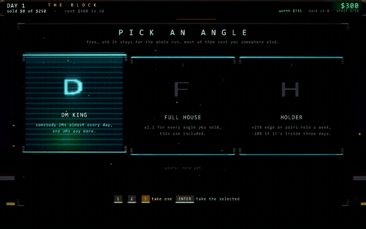 | 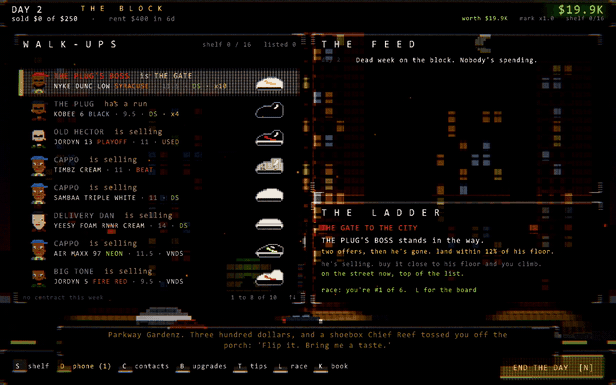 |
| 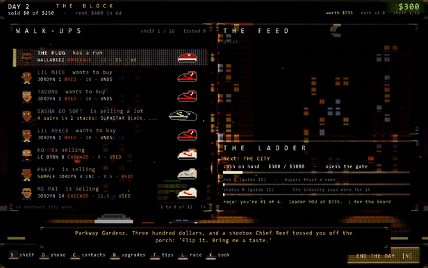 | 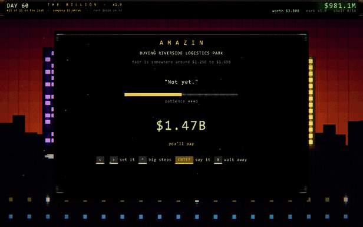 |

## Screenshots

| | |
|---|---|
| 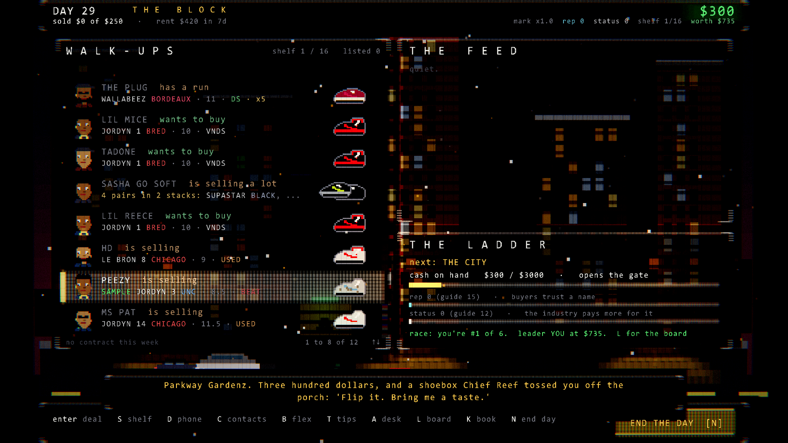 | 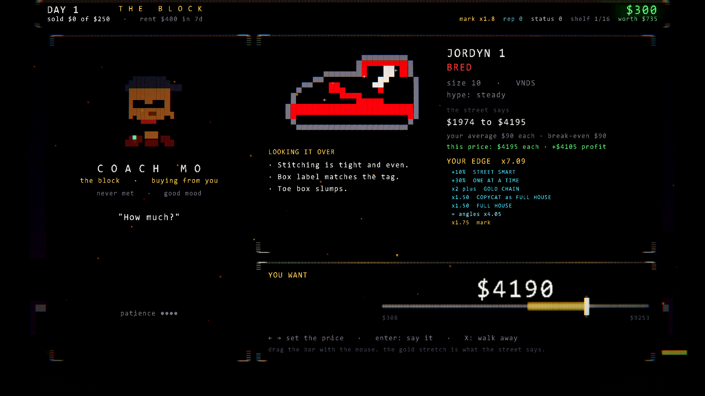 |
| 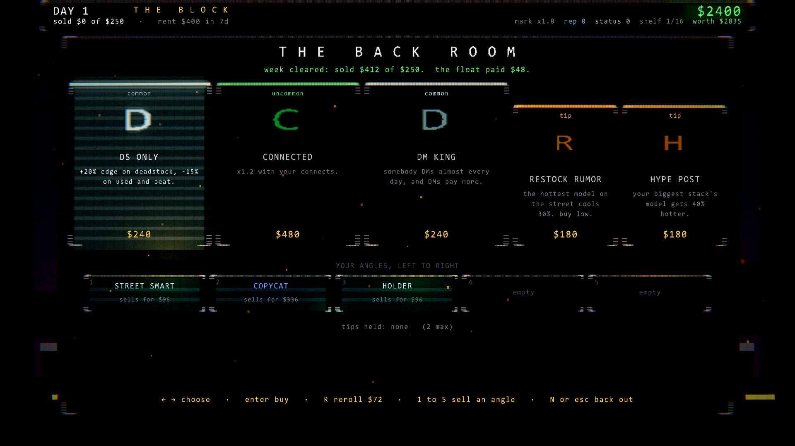 | 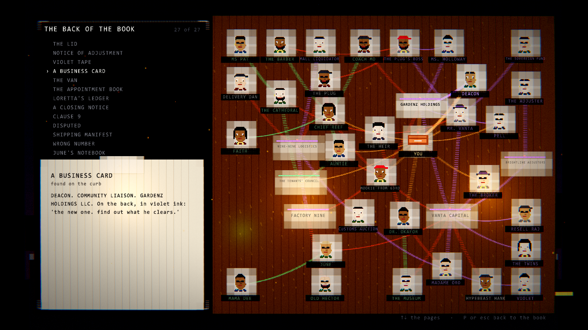 |
| 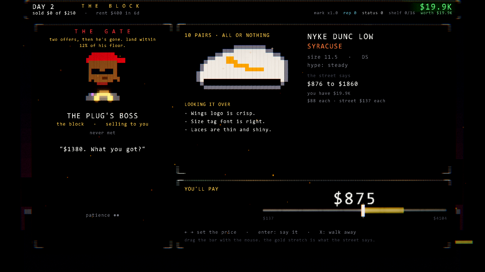 | 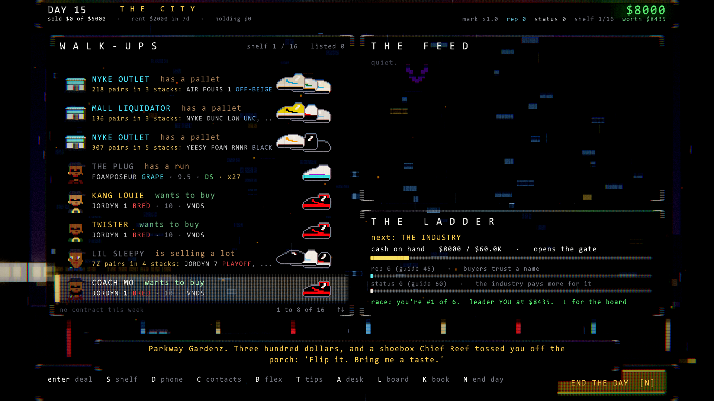 |
| 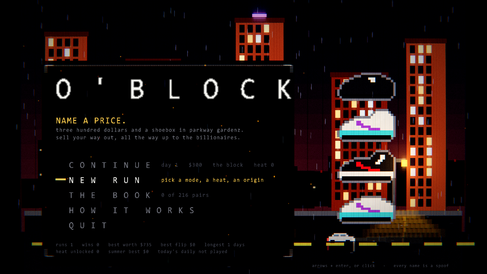 | 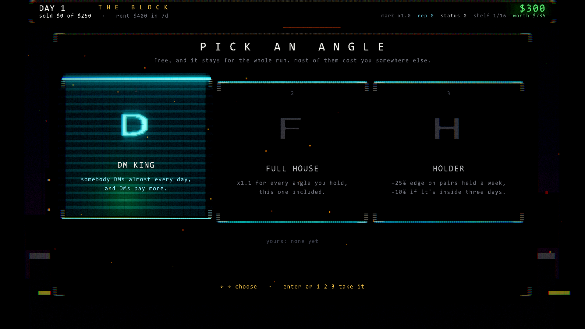 |
| 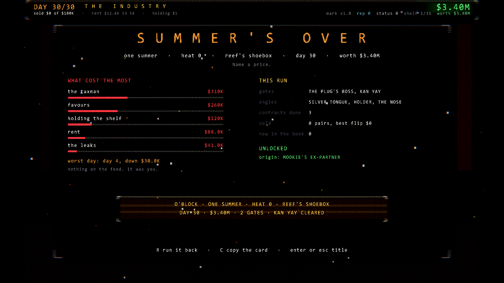 | 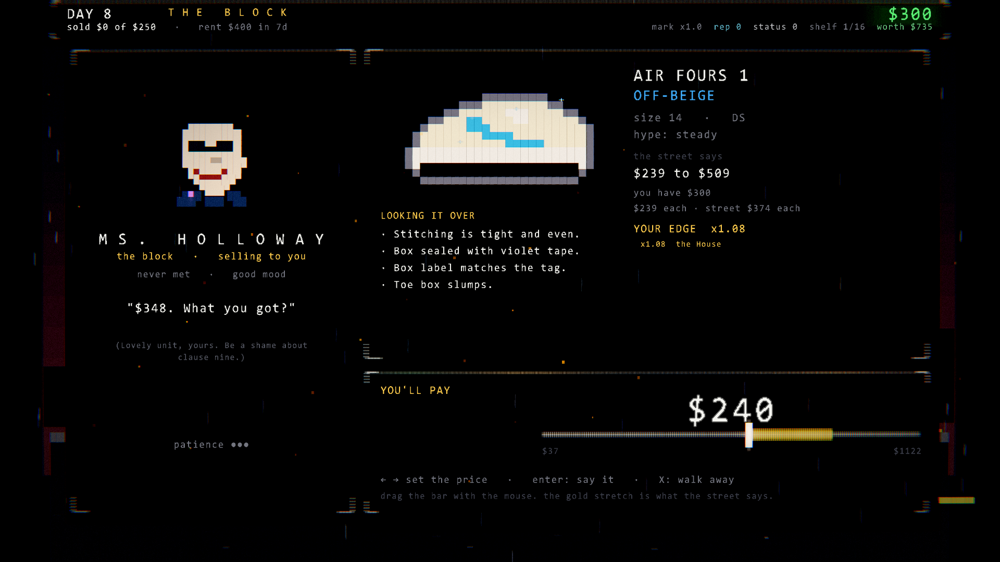 |

Logos and capsule art: [`art/`](art/).

## Use

Screenshots, GIFs, clips and art in this repo are free to use in coverage, videos and streams of O'BLOCK. Monetized videos are fine.

## Contact

Matthew Busel · mattbusel@gmail.com · [@MattBusel on X](https://x.com/MattBusel)

Keys aren't needed: the game is free on Steam from October 20.
